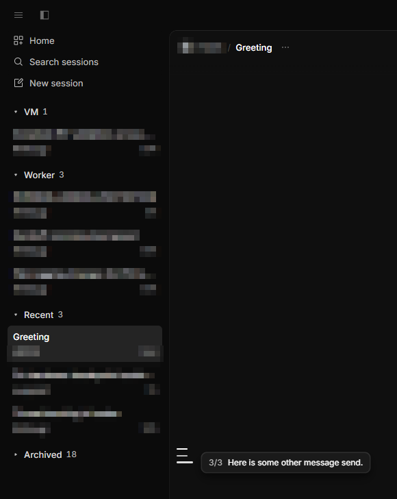

# opencode-ui-tweaks

A plugin for OpenCode Desktop 2.3.x: your own sections, right-click menus and collapsible groups in the Inbox sidebar, the action buttons under your messages that 2.3 moved into a menu, and a jump rail for the messages you sent.



It is not an official OpenCode plugin. The plugin API has no extension point for the sidebar or the timeline, so parts of it rely on the app's markup and can stop working after an app update; see [How it hooks in](#how-it-hooks-in-and-what-can-break). When that happens the app's own interface shows as before. Written and tested for Desktop 2.3.2.

## What it does

- **Keeps the app on the Inbox layout.** When a window starts with Top tabs or Side tabs, the plugin opens Settings › General, chooses Inbox under Interface mode and goes back. It tries once per window. If it cannot find the setting, it shows a notice with an "Open Settings" button instead. Turn this off under Settings › Sidebar.
- **Shows its own session list** in place of the app's Inbox list, top to bottom:
  - **Needs attention**: sessions waiting on an approval or an answer, longest wait first. A session that belongs to a section shows here while it waits, then returns to its section. Turn this off under Settings › Sidebar to keep such sessions in place with a dot.
  - **Your sections**, one level deep, each collapsible. A collapsed section still shows the session that is open, and marks on its header for what it hides: a spinner for a running session, a dot for an unviewed result.
  - **Recent**: sessions without a section, the ten newest with "Show more". Sessions that are open, running or unviewed always show.
  - **Archived**: a collapsible section, collapsed at first. It lists the newest 50 archived sessions per server.
- **A running session stays where it is** and shows a spinner. Rows sort by when their last run ended, which does not change during a run, so nothing moves while a session works. When the run ends the session moves to the top of its section or of Recent.
- **Right-click menus**
  - Empty area or a group header: New session, New section.
  - A section header: also Rename, Move up, Move down, Delete (its sessions go back to Recent).
  - A session: Move to section, Remove from section, Rename, Mark as read, Archive or Unarchive, Delete.
- **Drag and drop**: drag a session onto a section, or onto Recent to take it out of its section. Drag a section by its header onto another section to reorder: the upper half drops it before, the lower half after.
- **Buttons under your messages**: Desktop 2.2 showed action buttons under every message you sent; Desktop 2.3 moved them into the ▾ menu that appears when you hover the bubble. The plugin puts the rows back, in the line under the bubble. Turn them off under Settings › Sidebar.
  - **A sent message**: Revert to here, Fork from here, Copy. The row shows while the pointer is over the message, next to the agent and model. Each button runs the app's own action, so Revert puts the prompt back in the composer and offers Undo as usual. A subagent's session offers Copy only, as in the app.
  - **A waiting message** (sent while the agent works): Interrupt and send now, Move to queue, Delete, Copy, next to "Pending". **Interrupt and send now** (≫) is the plugin's own addition: it stops the step the agent is on and delivers the waiting message at once, instead of at the next step boundary. Finished tool calls and edits are kept; prompts you moved to the queue stay there.
- **Jump rail**: at the left edge of the open session, centered in its height, a short line for each message you sent. The line under the pointer grows and brightens, its neighbours a little, and a preview shows the start of that message and its place (3/12). A click goes to the message, also to one far up that the app has not loaded yet. The line of the message you are reading is marked. A session with a single message shows no rail, and neither does a narrow window. Turn it off under Settings › Sidebar.
- **Command palette**: "Sidebar: New section" and "Sidebar: Switch to Inbox layout".
- **Settings › Sidebar**: the layout switch, the Needs attention group, the message buttons, the jump rail, the list of sections, and whether the list is active in the window.

Sections and their sessions are stored by the app for this plugin (`plugin.sidebar-sections.sidebar`), on this computer, shared by all windows.

## Install

1. Update OpenCode Desktop to 2.3.x. `opencode upgrade` updates the command line tool only; the Desktop app updates itself and applies the update when it restarts.
2. Put the plugin in a folder next to your OpenCode config. The built bundle is in the repository, so there is nothing to build:

   ```bash
   git clone https://github.com/quietwell/opencode-ui-tweaks.git ~/.config/opencode/ui-tweaks
   ```

   Without git, download the repository as a ZIP and copy `package.json`, `src/` and `dist/` to `~/.config/opencode/ui-tweaks/`. On Windows, `~` is `C:\Users\<you>`.
3. Add the folder to `"plugins"` in `~/.config/opencode/opencode.jsonc`:

   ```jsonc
   {
     "plugins": ["./ui-tweaks"]
   }
   ```
4. Quit and reopen OpenCode Desktop.

Settings › Extensions › Plugins lists the plugin as `sidebar-sections`, with a switch that turns its Desktop part off and a Reload button. `opencode api plugin.list` shows whether the server loaded it.

To update, run `git pull` in the folder and press Reload. To remove the plugin, take the line out of `opencode.jsonc` and delete the folder; your sessions are untouched, only the sections are gone.

## How it hooks in, and what can break

The Desktop plugin API has no extension point for the session sidebar or the message timeline, so four things read the app's own markup:

- **The list** mounts inside the element `[data-slot="sidebar-inbox"]` and a stylesheet hides the app's rows while it is there. If an app update renames that element, the plugin mounts nothing and the app's own Inbox list shows as before. If the list fails to render, it is removed and the app's list shows.
- **The layout switch** clicks the Inbox radio button of `[data-component="interface-mode"]` in Settings › General. If an update moves it, you get the notice with the button instead.
- **The message buttons** are added to `[data-slot="user-message-copy-wrapper"]` of a `[data-component="user-message"]`. If an update renames those elements, no buttons show and the app's ▾ menu is unaffected.
  - On a waiting message (`data-pending`) they call the same server operations as the app's menu items (`session.inbox.update` and `session.inbox.cancel`); Interrupt and send now calls `session.interrupt` with `resume`.
  - On a sent message they choose the item in the message's own ▾ menu, with the menu kept invisible meanwhile: a pointer press on the menu's trigger, then a pointer release on the item with the matching icon (`copy`, `fork`, `reset`). Reverting and forking need app code a plugin cannot call, which is why they go through the menu. If the item is not there, a notice says so. If an update draws the items differently, the app's menu is left open for you to choose from; Copy then takes the text the page shows.

- **The jump rail** mounts in `[data-slot="session-timeline-visible"]`, the app's box over the visible part of the timeline, and takes the messages from the plugin API's session data. The timeline is virtualized, so a far message is not in the page; the app brings one into view when its route's hash is `#message-<id>`. The rail sets that hash by clicking a hidden link of its own, which the app's router follows like any link in the page. A link the router does not take is stopped, so the window never loads an address; then only messages already in the page are scrolled to. The marked line is read from the rows' `data-message-id`. If an update renames the box, no rail shows.

Everything else uses the plugin API: session data, opening tabs, dialogs, commands, storage and the settings page.

## Limits

- The list replaces the app's Inbox list, so later changes to that list do not appear here.
- Permission requests that the app auto-approves for a project can show a session under Needs attention for a moment; the app's auto-approve setting is not available to plugins.
- The list shows the newest 50 sessions per server, the page size the app's Inbox uses. A session beyond that is not listed; its section assignment is kept.
- Sections are per computer. They are not stored on the server.
- A waiting message that consists only of attachments gets no buttons; the app gives it no id in the page. Use its ▾ menu.
- When you send several messages in a row, the app shows the line under the bubble only for the last one. The earlier ones get no row; use their ▾ menu.
- The jump rail lists the messages the app has loaded for the session. In a very long session the oldest ones appear once the app loads them, e.g. after scrolling up.
- The tests (`npm test`) run the built bundle in a simulated window, not in the running app. The steps on the app's ▾ menu are tested against the menu component the app uses (Kobalte 0.13.13), and the jump against the router it uses (@solidjs/router 1.0.0), not against the app itself.

## Development

```bash
npm install
npm run typecheck
npm test
```

`npm test` builds the bundle and runs four things:

- `test/model.test.ts`: the logic tests.
- `test/menu-drive.test.mjs`: `src/drive.ts` against a real Kobalte dropdown menu in jsdom, with the markup the app gives a message's ▾ menu.
- `test/jump.test.mjs`: `src/jump.ts` against the routing and link handling of the real @solidjs/router, on a memory source like the Desktop's.
- `test/gui-render.cjs`: loads `dist/gui-experimental.cjs` in jsdom with a fake server and a stand-in for the app's Inbox sidebar. It drives sections, the menus, drag and drop, running sessions, Archived, the message buttons, the jump rail and the layout switch.

| File | What it holds |
|---|---|
| `src/model.ts` | Stored state and its edits, session status, arrangement into groups. No DOM. |
| `src/inbox.ts` | The sessions of every listed server with their status, and the actions on them. |
| `src/list.tsx` | The list, its groups, rows, menus and drag and drop. |
| `src/menu.tsx` | The right-click menu. |
| `src/messages.tsx` | The buttons under a sent and under a waiting message. |
| `src/drive.ts` | Choosing an item in the app's own message menu. |
| `src/rail.tsx` | The jump rail. |
| `src/jump.ts` | Going to a message through the app's router, and finding the message in view. |
| `src/layout.ts` | Finding the Inbox sidebar and switching the layout. |
| `src/gui.tsx` | The plugin definition: store, mounting, commands, settings page. |
| `src/index.ts` | The server part; it only gives the plugin its id. |

## License

MIT, see [LICENSE](LICENSE).
